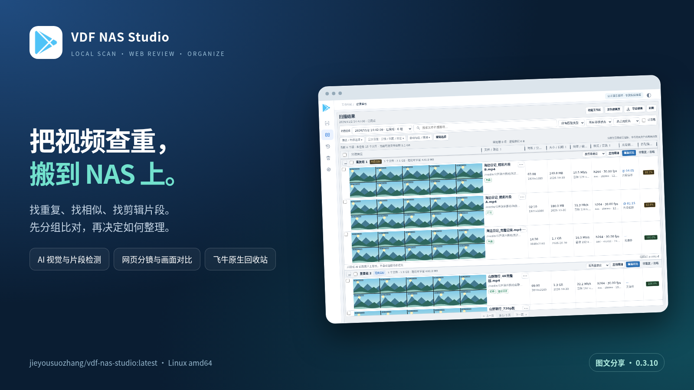
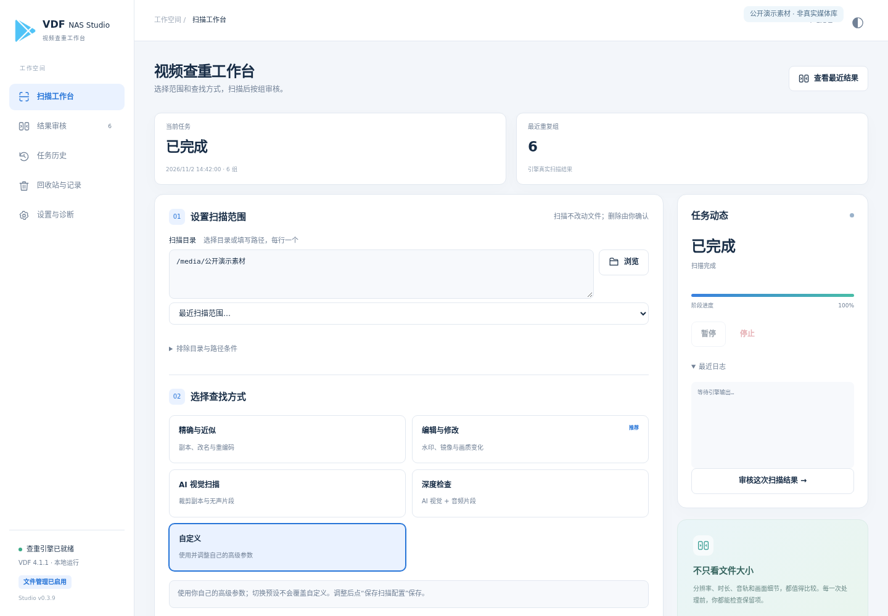
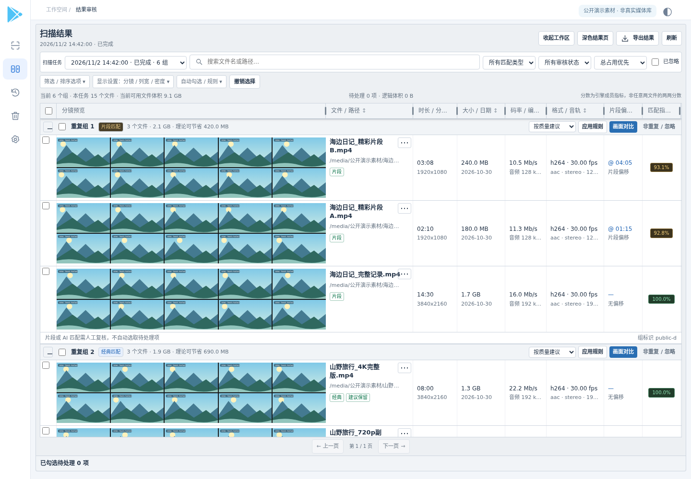
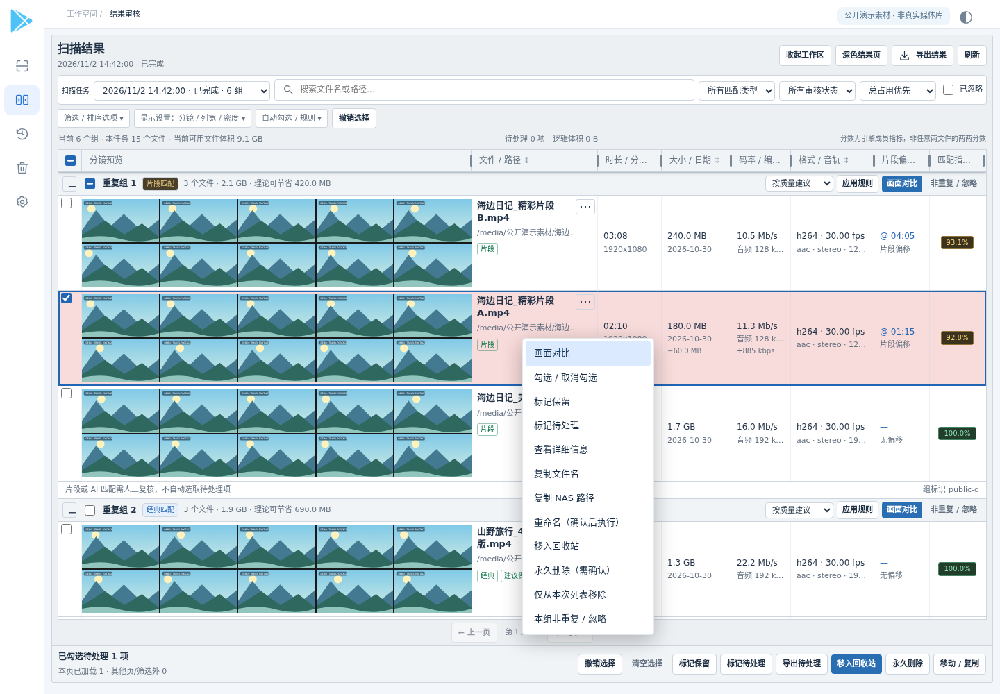
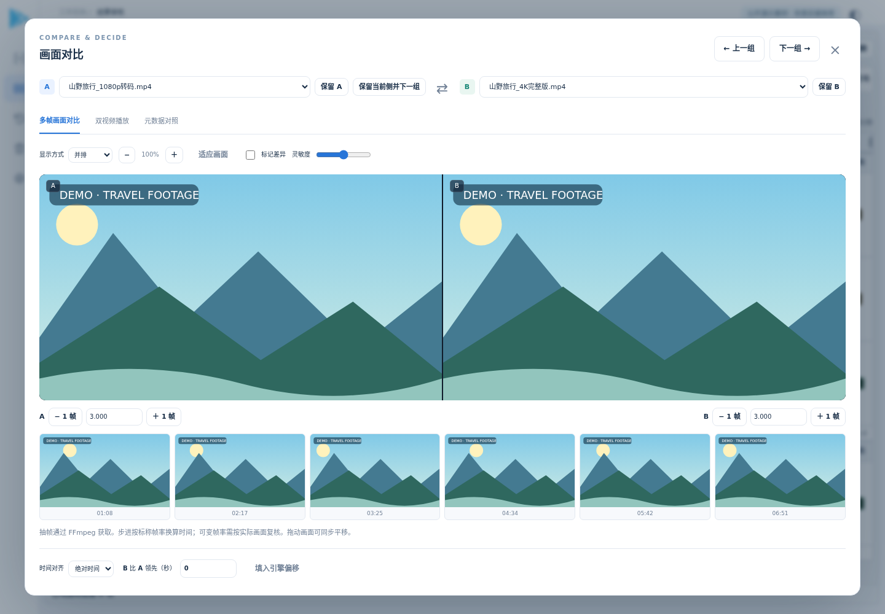
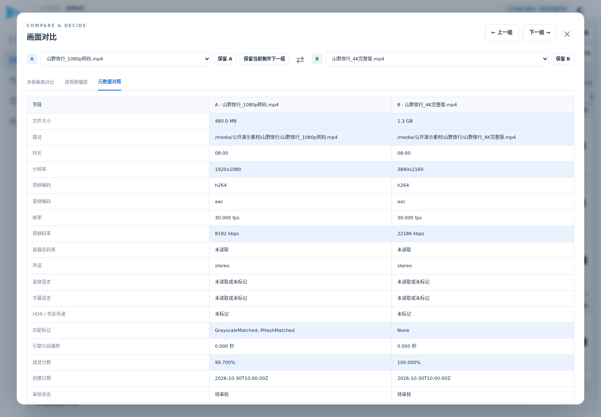
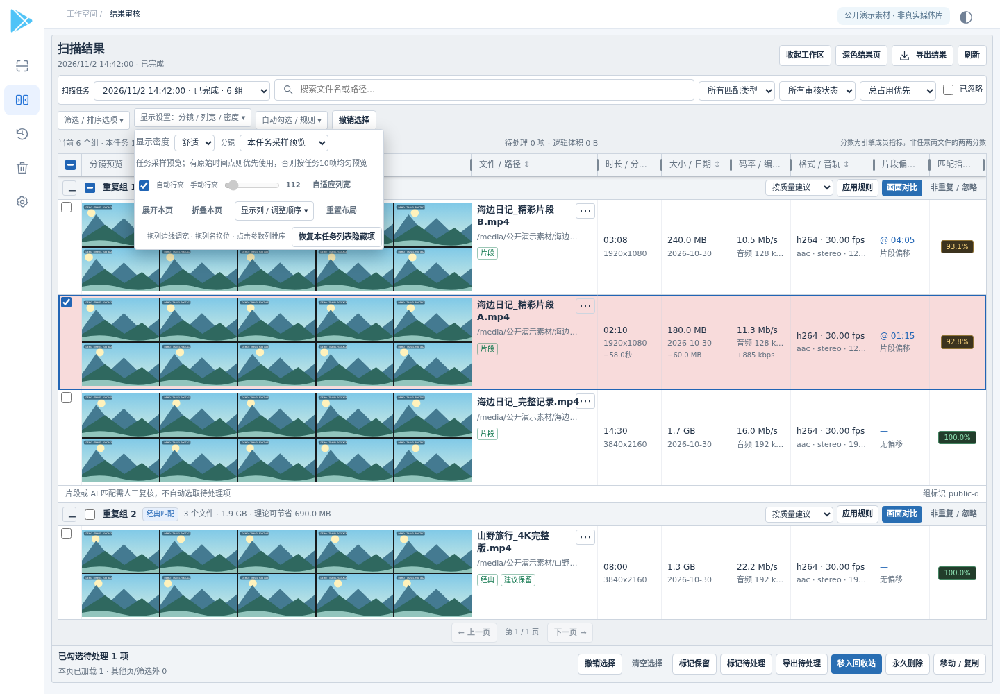
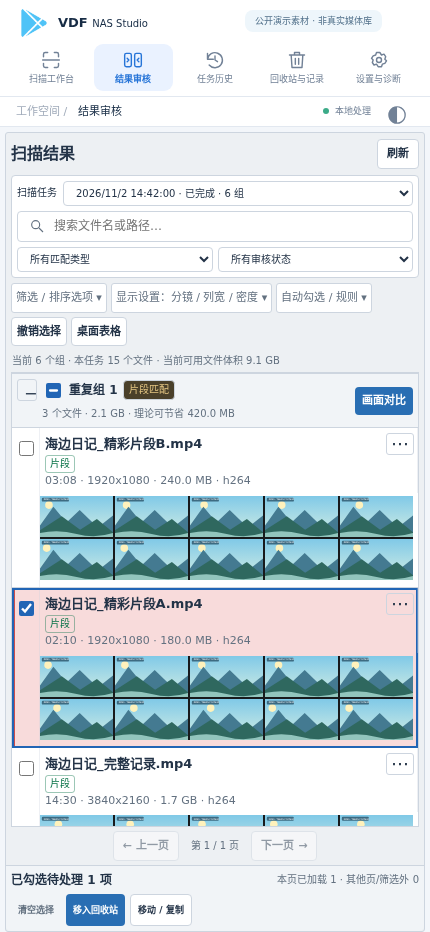

# 【自制工具分享】VDF NAS Studio：在 NAS 上找重复视频、相似画面和剪辑片段，网页对比后再整理



视频文件多了以后，最麻烦的往往不是“磁盘上有两个同名文件”，而是同一段内容被改过名字、转成另一种清晰度，或者只保留了其中一部分。仅靠文件名和体积，很难判断哪些值得保留。

我把 **Video Duplicate Finder 的官方 Linux 引擎**接成了一个适合 NAS 使用的网页工作台：扫描在 NAS 本机完成，电脑和手机用浏览器查看结果，按组对比，再决定哪些保留、哪些整理。它叫 **VDF NAS Studio**，不是重新写一套识别算法，也不是通过远程桌面运行 Windows 软件。

- **Docker Hub**：[jieyousuozhang/vdf-nas-studio](https://hub.docker.com/r/jieyousuozhang/vdf-nas-studio)
- **部署标签**：`jieyousuozhang/vdf-nas-studio:latest`
- **本文对应版本**：`0.3.10`，当前 `latest` 指向该版本；引擎为 VDF `v4.1.1`。
- **平台**：`linux/amd64`，当前没有 ARM64 镜像。

> 文中界面截图来自当前镜像的实际网页，使用独立的旅行、夜景等**示例数据和演示分镜**，不是我的真实视频库，也不是用来证明识别准确率的测试素材。截图中的数量、容量及分数只用于说明操作方式。

## 一、它主要解决什么问题？

我的目标不是“扫描完自动删一遍”，而是把视频整理过程中最费时间的几步集中起来：

1. 找出疑似重复或相似内容，不局限于文件名相同。
2. 把同组文件的分镜、时长、清晰度、大小、编码与音轨放在一起看。
3. 比较完整视频与节选片段，辅助判断内容是不是重叠。
4. 人工确认后，再执行保留、回收、重命名或移动等操作。

它更适合整理本地视频收藏、旅行素材、录屏、转码副本和混杂的视频目录。**扫描结果是待审核的候选，不是已经被证明可以删除的清单。**

## 二、扫描方式：普通查重、AI 视觉与片段检测

工作台提供「精确与近似」「编辑与修改」「AI 视觉扫描」「深度检查」四种预设，也可以保留独立的自定义参数。切换预设时，界面会提示参数变化，不必每次从头填写。



几种方式各有侧重：

| 方式 | 主要用途 | 使用时的理解 |
|---|---|---|
| 灰度 / pHash / 组合匹配 | 改名副本、转码版本、相似画面 | 根据抽样画面比较，不是逐字节文件哈希 |
| AI 视觉匹配 | 更复杂的视觉变化、编辑后的副本 | 更耗资源，仍需要人工复核 |
| AI 视觉片段检测 | 完整视频与其中的节选、无声片段等 | 使用密集关键帧特征，不等同于普通缩略图数量 |
| 音频片段检测 | 具有可比较音轨的内容片段 | 依赖可用音频，可结合视觉确认 |

可以限制扫描目录、排除某些路径，调整相似度、抽样数量以及读取和匹配并发。**选中某个预设不代表所有视频都能识别，也不是开启越多选项就越适合所有素材。**

如果是第一次使用，我更建议先选一个小目录，熟悉结果的含义，再扩大范围。

## 三、结果页：参考桌面端的审核习惯

扫描完成后，结果以分组方式展示。每个组可以展开或折叠，查看文件名、分镜、大小、时长、分辨率、帧率、视频编码和音轨信息，并按需要搜索、筛选与排序。



结果页尽量保留桌面工具的操作习惯：

- **行高亮和复选框分开**：点亮一行表示当前关注它，勾选才表示准备处理它。
- 支持 Shift 范围勾选、空格勾选、快捷键和右键操作菜单。
- 可以标记保留项、标记待处理项，以及按内置规则辅助选择。
- 支持本页规则和全部筛选结果规则，操作范围会明确显示。
- 列宽可拖动、列顺序可调整，刷新与排序时尽量保留滚动位置。
- 大组成员可以继续展开，排序覆盖整个分组，而不只是当前加载的几行。



这里有两个需要区分的地方：**“推荐保留”不是内容质量鉴定；“相似度”也不一定是这个组内任意两个文件之间的直接分数。** 不同编码不能简单地按码率比较优劣，清晰度更高的文件也不一定内容更完整。

页面提供选择撤销，但它撤销的是勾选或规则标记，**不是已经执行的文件操作**。处理过的文件要从相应的恢复入口核实。

## 四、画面对比：先看内容，再决定保留哪一个

我觉得这部分比“多显示几列参数”更重要。进入画面对比后，可以选择左右两份文件，查看分镜、放大画面、调整显示方式，并通过时间偏移辅助对齐片段。



对比界面支持在不同结果组之间继续切换，也可以“保留当前并下一组”，减少反复关闭弹窗、寻找下一组的操作。

除了画面，还有元数据对照页，方便把时长、清晰度、帧率、编码和音轨等放在一起查看。



分镜预览优先使用引擎导入的真实采样时间点；没有时间点时，会按任务采样数量生成均匀预览。额外选择的浏览分镜只用于查看，**不会自动改变已经完成的扫描质量**。

双视频播放还受浏览器支持的编码、音频格式和服务端预览能力影响，不能把任意一个本机能解码的文件都当成浏览器一定能直接播放。

## 五、显示设置与手机使用

网页不是只适合大屏表格。桌面可以使用紧凑或舒适密度，调整分镜、列宽与列顺序；手机默认采用摘要和分镜布局，不要求把完整桌面表格硬塞进窄屏。



手机也可以选择文件、打开操作菜单和画面对比。需要查看完整参数表时，还能切回桌面表格。



任务、筛选、显示密度和部分工作现场会保存，回到页面时不用每次重新找位置。电脑与手机各自的显示环境不同，不能把它理解成所有布局设置在不同设备上实时同步。

## 六、文件整理：支持飞牛原生回收站

除了标记保留，应用还提供仅从结果列表隐藏、重命名、移动、复制、移入回收站及永久删除等处理入口。相关操作需要开启文件管理，并经过预览或确认；保留项和文件身份会参与保护检查。

**0.3.10 的重点是飞牛原生回收站适配。** 正确配置后，文件进入飞牛自身的回收站，而不是在共享目录根下另建一套应用回收站。可以在飞牛原生回收站中找到对应文件，应用也提供恢复入口。

这不是拿 NAS 的账号密码去远程调用删除接口：应用使用配置好的目录映射与文件系统记录完成操作。若用户、目录身份或回收站条件不满足，会拒绝操作，**不会悄悄回退成永久删除**。

几个操作的区别也值得说明：

| 操作 | 是否影响真实文件 |
|---|---|
| 标记保留 / 待处理 | 保存审核决定，不直接移动文件 |
| 仅从结果列表隐藏 | 不删除媒体，可以恢复列表显示 |
| 移入回收站 | 实际移动文件，后续从回收站恢复 |
| 重命名 / 移动 / 复制 | 实际修改文件名、位置或生成副本 |
| 永久删除 | 实际删除，需要确认和所配置的文件处理密码 |

飞牛模式要求**共享目录、用户根目录和原生回收站属于正确的同一映射关系**。这也是下方 Compose 同时挂载 `/media` 与 `/fnos-user` 的原因。不要把不同磁盘、不同用户的目录随意拼在一起。

如果只想先看识别效果，不需要让应用碰文件，可以使用后面的**只读扫描配置**。

## 七、Docker Compose 部署

下面是主要面向 **飞牛 + Intel 核显** 的部署示例。它使用当前实际可拉取的 `latest` 标签，不需要自行构建镜像，也不需要挂载 Docker Socket。

### 1. 先核对几个值

- **媒体路径**：示例使用 `/vol1/1000/视频`，请改成你的真实共享目录。
- **用户根路径**：示例为 `/vol1/1000`，须包含上述共享目录。
- **UID / GID**：示例为 `1000:1001`，按目标 NAS 的实际用户修改。
- **render 组**：示例 GID 为 `105`，通过 `ls -ln /dev/dri/renderD128` 查看设备实际组号。
- **回收站**：先在飞牛中启用该共享的原生回收站，并用无关紧要的测试文件确认回收、恢复正常。
- **确认密码**：把示例中的 `ChangeThis_ToYourOwnLongPassword` 换成自己的不少于 12 个字符的密码。

下面三个位置必须对应：

```text
宿主媒体目录：/vol1/1000/视频
宿主用户根目录：/vol1/1000
共享相对目录名：视频
```

### 2. 保存为 docker-compose.yml

```yaml
name: vdf-nas-studio
services:
  studio:
    image: jieyousuozhang/vdf-nas-studio:latest
    platform: linux/amd64
    init: true
    restart: unless-stopped
    pull_policy: always
    user: "1000:1001"                 # 按你的飞牛用户 UID:GID 修改
    ports:
      - "8098:8098"
    cpus: 2.0
    cpu_shares: 512
    pids_limit: 256
    stop_grace_period: 20s
    devices:
      - /dev/dri/renderD128:/dev/dri/renderD128
    group_add:
      - "105"                        # 按实际 render 设备组 GID 修改
    environment:
      VDF_PASSWORD: "ChangeThis_ToYourOwnLongPassword"
      VDF_DEFAULT_HW_ACCEL: vaapi
      LIBVA_DRIVER_NAME: iHD
      VDF_ALLOW_FILE_ACTIONS: "true"
      VDF_RECYCLE_BACKEND: fnos
      VDF_FNOS_USER_ROOT: /fnos-user
      VDF_FNOS_MEDIA_RELATIVE: 视频    # 对应下方用户根目录里的共享目录名
      VDF_FNOS_UID: "1000"            # 与上方 UID 及回收站所属用户一致
      VDF_SECURE_COOKIE: "false"
      VDF_CACHE_GB: "4"
      VDF_SCAN_TIMEOUT_HOURS: "72"
    volumes:
      - ./data:/data:rw
      - /vol1/1000/视频:/media:rw       # 示例：要扫描的共享目录
      - /vol1/1000:/fnos-user:rw        # 示例：同一共享所属的用户根目录
    cap_drop:
      - ALL
    security_opt:
      - no-new-privileges:true
    logging:
      driver: json-file
      options:
        max-size: "10m"
        max-file: "3"
```

`VDF_FNOS_UID` 要与运行 UID 及原生回收站所属用户一致；`VDF_FNOS_MEDIA_RELATIVE` 可以是用户根下的相对路径，但不能是绝对路径或包含 `..`。

在 NAS **宿主机**的项目目录中执行：

```bash
mkdir -p data
# 确保该目录允许你在Compose中设置的UID/GID读写。
docker compose config --quiet
docker compose up -d
```

浏览器访问：

```text
http://你的NAS局域网IP:8098
```

如果 8098 已被其他应用占用，只修改端口映射左侧，例如 `18098:8098`。`./data` 是项目目录下的持久数据目录，升级或重建容器时不要删除。

当前工作台直接打开，**没有入口账号登录**。`VDF_PASSWORD` 是文件处理确认密码，不是网页访问密码。这个部署更适合可信内网；远程访问可由 VPN 或带认证的反向代理提供访问控制。

### 3. 没有核显，或只想只读试用

分享包中附有 `compose.scan-only.yml`：关闭文件操作、CPU 解码、媒体只读，不要求飞牛原生回收站映射。适合先验证扫描和审核流程，也可作为其他 x86-64 Linux/NAS 环境的起点。

先修改文件里的 `/path/to/videos`、运行 UID/GID 和确认密码，然后执行：

```bash
docker compose -f compose.scan-only.yml config --quiet
docker compose -f compose.scan-only.yml up -d
```

两份 Compose 是**二选一**，不要在同一端口同时启动。只读试用时，应用不会在媒体目录中建立回收站。

## 八、核显加速、AI 与扫描耗时

当前镜像包含 Intel VAAPI 相关驱动，已在支持的 Intel 核显环境验证解码。它主要加速的是视频读取/解码等环节，**AI 推理仍使用 CPU**，不是把整套 AI 运算搬到核显上。

首次启用 AI 时，需要下载对应的模型和 Runtime，保存到持久数据目录。视频分析在本机进行，下载 AI 组件并不需要上传你的视频。

耗时与视频总时长、编码、分辨率、磁盘读盘、抽样数量和启用的检测阶段都有关系。深度扫描中，普通采样完成后还可能继续音频或 AI 密集采样，不能只看一个阶段的进度判断整个任务快结束。

我不建议直接把并发拉满。示例保留 2 核上限和较低的 CPU 争用权重，没有设置内存硬上限。**我自己 NAS 上额外部署的 2～3 核自适应守护是宿主服务，不在这个镜像里，其他机器部署后不会自动获得该功能。**

抽样数量也不是单纯的“预览图片多少”。曾对少量边界样本重复验证，固定 3 帧可能恰好都落在黑场或暗场，增加到 10 帧能改善部分候选，但不保证所有结果都与 Windows 一致。想比较两端效果，应先统一采样数量、检测选项、阈值、引擎版本与素材范围。

## 九、暂停、历史和缓存：能复用，但不是精确断点

任务历史、审核决定和扫描特征保存在数据目录。对于身份未改变的文件，人工保留决定可以按条件继承，不会单凭相同文件名盲目套用。

暂停与跨重启要分开理解：

- **同进程暂停 / 恢复**：保留进程状态，暂时让出资源。
- **容器重启或任务中断后**：按已保存缓存继续计算，不是从停止时的那一行精确恢复。
- 密集 AI 已有周期检查点，但落盘检查发生在文件完成边界；单个未完成视频以及尚未提交的部分仍可能重算。

因此，不会承诺“重启完全不重算”或“最多只损失一分钟”。长期扫描过程中，非必要不反复重启容器。

## 十、升级与备份

`latest` 是浮动标签。本文发布时它对应 `0.3.10`；以后更新镜像时，可能会对应新的版本。需要固定版本时，把 Compose 的镜像改为 `jieyousuozhang/vdf-nas-studio:0.3.10`。

建议先确认没有需要保留进程状态的扫描任务，再备份整个 `data` 目录，然后更新：

```bash
docker compose stop
# 此时对整个data目录做一致性备份，备份位置按自己的目录安排。
docker compose pull
docker compose up -d
```

不要只备份缩略图，也不要删除 SQLite、引擎库或 AI 状态目录来“清缓存”。媒体仍留在原挂载目录，容器更新不等于媒体迁移。

## 十一、常见问题与当前边界

**1. 扫描后会自动删文件吗？**  
不会。扫描、审核标记和真实文件操作是分开的。应用会给候选结果，最终保留与处理仍由你确认。

**2. 分组里一定都是同一个视频吗？**  
不一定。近似检测可能把相似背景、相同片头、同一场景或部分重叠素材放进候选；尤其要复核接近阈值的分组。不要拿结果组数当准确率。

**3. 为什么视频能在电脑播放，但网页不一定能播？**  
浏览器的编码支持与本机播放器不同。可以先用分镜、元数据和预览功能核实，不能保证任意编码都原样直播到浏览器。

**4. 打不开页面或提示 data 无权限？**  
先看端口、容器日志、挂载路径和 UID/GID；确认 `data` 可写。不建议用 `chmod 777` 代替正确的权限配置。

**5. 飞牛回收站配置校验失败？**  
检查共享回收站是否启用、回收站所属用户与 UID 是否一致，以及两个宿主挂载是否指向同一共享。别通过删除检查或修改回收站元数据来绕过。暂时只想使用扫描，可以改用只读配置。

**6. ARM、Windows、其他 GPU 能直接用吗？**  
本次镜像只提供 Linux amd64。Windows 可以用浏览器访问 NAS 上的工作台，但这不代表提供 Windows 容器或任意显卡加速。

**7. 为什么部分界面页脚还写着 0.3.9？**  
0.3.10 主要增加原生回收站适配，部分静态页脚尚沿用 0.3.9。镜像的实际服务版本可以通过 `/api/health` 查看，本次发布已核对为 0.3.10。

**8. 和 Windows 端完全一样吗？**  
审核流程参考桌面端，但不是完整复刻；复杂自定义选择表达式、软硬链接替换、网页直接打开 Windows 资源管理器等未实现。不同采样与解码环境下也不承诺逐组完全一致。

## 十二、最后

这款工具更像是视频库的一个“整理工作台”：让 NAS 负责耗时的分析，让浏览器负责展示、比较和确认，而不是替你直接决定哪些文件不值得保留。

如果你也遇到同内容不同文件名、多个清晰度副本和完整视频混着片段的情况，可以先从一个小目录试用。

- 镜像：[Docker Hub](https://hub.docker.com/r/jieyousuozhang/vdf-nas-studio)
- 上游引擎：[Video Duplicate Finder](https://github.com/0x90d/videoduplicatefinder)
- 上游固定源码提交：`21ec967e2e108bb9a2f09f937be000fb1e2c3615`
- 应用与引擎许可证信息：见 [LICENSE](LICENSE) 与 [致谢和来源](ACKNOWLEDGEMENTS.md)。

这份仓库分享包包含图文、配图与部署示例，**不是完整应用源码归档，也不包含镜像 tar、个人媒体、扫描数据库或登录凭据**。程序使用上述 Docker 镜像部署。
